<div align="center">

# Fashion Store

**Cửa hàng thời trang server-rendered bằng Laravel: mua hàng, thanh toán VietQR qua SePay, trợ lý AI và khu quản trị.**

[](https://github.com/Thinha1/fashion-store/actions/workflows/ci.yml)
[](https://sonarcloud.io/summary/new_code?id=Thinha1_fashion-store)


</div>

## Tổng quan

Fashion Store là ứng dụng Laravel monolith phục vụ hai nhóm người dùng:

- **Khách hàng** tìm sản phẩm (bằng chữ hoặc bằng ảnh), hỏi trợ lý AI, đặt hàng, thanh toán COD hoặc chuyển khoản VietQR và theo dõi đơn.
- **Nhân viên quản trị** quản lý catalog, nhập kho, đơn hàng và thanh toán trong phạm vi quyền được cấp, có trợ lý AI soạn và sửa sản phẩm.

Ứng dụng dùng Blade để render phía server. Tailwind CSS, Alpine.js và Font Awesome cung cấp giao diện cùng các tương tác nhẹ; dữ liệu nghiệp vụ được lưu trong MySQL.

Bảng đánh giá, yêu thích và đổi/trả đã có trong schema nhưng chưa có giao diện.

## Chức năng hiện có

### Cửa hàng

- Trang chủ với sản phẩm nổi bật; trang bộ sưu tập theo thương hiệu.
- Danh sách sản phẩm có phân trang, lọc danh mục ba cấp, lọc thương hiệu và sắp xếp.
- Tìm kiếm bằng Meilisearch: chấp nhận gõ sai, gõ không dấu, từ đồng nghĩa như đầm/váy. Bộ lọc size, màu (bảng màu chuẩn, có ô màu), khoảng giá theo giá đã giảm và còn hàng. Meilisearch không chạy thì tìm bằng MySQL.
- **Tìm bằng hình ảnh**: khách tải ảnh lên, AI (model đọc được ảnh) mô tả loại đồ, màu và kiểu dáng, rồi hệ thống tìm sản phẩm khớp trong catalog.
- Chi tiết sản phẩm với thư viện ảnh, ảnh đổi theo màu đang chọn, kích thước, SKU, tồn kho và sản phẩm liên quan.
- **Trợ lý mua sắm AI**: khung chat gợi ý sản phẩm có thật trong catalog, trả lời dạng stream.
- Giỏ hàng và thanh toán (bắt buộc đăng nhập). Giá và giảm giá tính tập trung ở `PriceCalculator`. Tồn kho được khóa khi đặt nên hai đơn cùng lúc không làm âm kho.
- Sổ địa chỉ theo đơn vị hành chính hai cấp mới (tỉnh, phường/xã), lấy từ `provinces.open-api.vn`.
- Thanh toán **COD** hoặc **chuyển khoản VietQR**: trang đơn hiện mã QR đã điền sẵn số tiền và nội dung là mã đơn. Webhook SePay tự đối soát, đơn chỉ chuyển "Đã thanh toán" khi khớp **cả mã đơn lẫn số tiền**. Trang đơn tự cập nhật khi tiền về.
- Danh sách và chi tiết đơn của chính mình; tự hủy được khi đơn còn chờ xác nhận và chưa thanh toán.
- Đăng ký, đăng nhập, xác minh email, đặt lại mật khẩu, cập nhật hồ sơ.

### Quản trị

- **Phân quyền** (`/admin/vai-tro`, `/admin/nhan-vien`): 21 quyền chia nhóm (hệ thống, catalog, kho, đơn hàng, khách hàng), tạo vai trò bằng cách tick quyền, tạo/khóa tài khoản nhân viên và gán vai trò. Sidebar, nút thao tác và trang đích sau đăng nhập đều theo quyền. Có sẵn 4 vai trò: Quản lý cửa hàng, Nhân viên bán hàng, Nhân viên kho, Nhân viên nội dung. Quy tắc an toàn: không cấp quyền vượt quá quyền của chính mình, không tự khóa hay tự gỡ quyền phân quyền, luôn còn ít nhất một người có quyền phân quyền; mọi thay đổi ghi vào nhật ký.
- Dashboard tổng hợp doanh thu, tổng đơn hàng và tổng sản phẩm, kèm biểu đồ doanh thu.
- Quản lý thương hiệu, danh mục, sản phẩm, biến thể và hình ảnh (ảnh riêng cho từng biến thể). Bật/tắt sản phẩm nổi bật ngay trong danh sách.
- Quản lý nhà cung cấp (tra cứu theo mã số thuế), giảm giá theo biến thể.
- Lập phiếu nhập ở trạng thái nháp, sau đó xác nhận để cập nhật tồn kho.
- **Đơn hàng**: lọc theo trạng thái đơn, trạng thái và hình thức thanh toán; chuyển trạng thái theo luồng `pending → confirmed → preparing → shipping → delivered` (kèm hủy), có lịch sử. Nút **Xác nhận đã nhận tiền** cho giao dịch chuyển khoản mà webhook không khớp được.
- **Trợ lý AI soạn sản phẩm** (khung chat trong khu quản trị):
  - soạn tên, mô tả, giá, size, màu, danh mục, thương hiệu từ ảnh, mô tả tự do hoặc file PDF (catalog, báo giá), rồi điền vào form để nhân viên xem lại trước khi lưu;
  - sửa nhanh từng trường bằng lời ("giá 199k", "ngừng bán sản phẩm này"). AI nhìn thấy trạng thái form hiện tại nên sửa đúng chỗ: "thêm size XL" chỉ thêm biến thể mới, giữ nguyên SKU, tồn kho, ảnh của biến thể cũ; "giá size 2XL là 350k" chỉ sửa biến thể 2XL;
  - chuyển trang ("sang trang đơn hàng") và mở sản phẩm theo tên hoặc SKU ("mở áo polo Coolmate");
  - mọi thay đổi có nút **Hoàn tác**; khi gỡ biến thể, khung chat hiện cảnh báo.
- **Nhật ký hệ thống** (`/admin/nhat-ky`): ai làm gì, lúc nào, trên dữ liệu nào, giá trị trước và sau; lọc theo hành động, người thực hiện, loại dữ liệu và ngày. Chỉ xem, không sửa hay xóa được.
- **Cấu hình AI**: lưu nhiều backend tương thích OpenAI (endpoint, model, key mã hóa), chọn cấu hình chính, kiểm tra kết nối trước khi lưu.
- **Cấu hình thanh toán QR**: ngân hàng, số tài khoản, tên chủ tài khoản, URL và API key webhook SePay; có xem trước mã QR và nút **Kiểm tra webhook**. Mục để trống dùng giá trị trong `.env`.
- Phân trang dùng chung (chọn 10/20/50 bản ghi mỗi trang); bấm tiêu đề cột để sắp xếp trên toàn bộ dữ liệu.

### Nhập và xuất Excel

Sáu nhóm dữ liệu hỗ trợ tệp `.xlsx`:

- Thương hiệu
- Danh mục
- Nhà cung cấp
- Sản phẩm và biến thể
- Giảm giá
- Phiếu nhập và các dòng hàng

Biểu mẫu nhập Excel mở trong dialog, có tải tệp mẫu và chọn tệp mới. Người dùng làm việc với tên danh mục, tên thương hiệu hoặc SKU thay vì phải tra ID nội bộ. Tệp tối đa 5 MB và 5.000 dòng; mỗi lần nhập chạy trong transaction nên lỗi ở một dòng sẽ hoàn tác toàn bộ tệp.

## Kiến trúc



[Xem mã nguồn Mermaid của sơ đồ](docs/architecture.mmd)

Luồng xử lý HTTP chính:

1. Nginx nhận request tại cổng `8080` và chuyển đến PHP-FPM.
2. Laravel route request qua middleware `auth`, `verified` và `permission` khi cần.
3. Form Request kiểm tra dữ liệu trước khi controller hoặc action thực thi nghiệp vụ.
4. Eloquent đọc hoặc ghi MySQL; file được lưu qua filesystem tương thích S3/MinIO.
5. Blade render HTML và dùng asset do Vite build.
6. Queue worker và scheduler xử lý tác vụ nền trong các container riêng.

## Công nghệ

| Thành phần | Công nghệ |
| --- | --- |
| Backend | PHP 8.4, Laravel 13, Eloquent ORM |
| Frontend | Blade, Tailwind CSS 4, Alpine.js 3, Font Awesome 7 |
| Build | Vite 8, Node.js 22 |
| Dữ liệu | MySQL 8.4 |
| File | Laravel Filesystem, MinIO/S3 |
| Excel | PhpSpreadsheet 5 |
| Tìm kiếm | Laravel Scout 11, Meilisearch 1.55 |
| AI | API tương thích OpenAI (DeepSeek), JSON mode, stream SSE |
| Thanh toán | VietQR, webhook SePay |
| Email phát triển | Mailpit |
| Chất lượng mã | Laravel Pint, PHPUnit 12, SonarQube Cloud |
| Môi trường | Docker Compose, Nginx, PHP-FPM |

## Chạy dự án bằng Docker

Yêu cầu: Docker Desktop và Git.

```powershell
git clone https://github.com/Thinha1/fashion-store.git
cd fashion-store
docker compose up -d --build
```

Ở lần chạy đầu, Docker Compose tự:

- cài dependency Composer;
- tạo `.env` từ `.env.example`;
- sinh `APP_KEY` và tạo storage link;
- chuẩn bị bucket MinIO;
- chạy migration;
- đồng bộ cấu hình index Meilisearch và import sản phẩm (`search-index`);
- khởi động web app, Vite, queue worker và scheduler.

Kiểm tra trạng thái:

```powershell
docker compose ps
```

| Dịch vụ | Địa chỉ |
| --- | --- |
| Website | <http://localhost:8080> |
| Health check | <http://localhost:8080/up> |
| Vite HMR | <http://localhost:5173> |
| Mailpit | <http://localhost:8025> |
| MinIO API | <http://localhost:9000> |
| MinIO Console | <http://localhost:9001> |
| Meilisearch | <http://localhost:7700> (key: `MEILISEARCH_KEY`) |
| MySQL từ máy host | `127.0.0.1:3307` |
| MySQL trong Docker | `mysql:3306` |

## Dữ liệu mẫu và tài khoản quản trị

Nạp seed:

```powershell
docker compose exec app php artisan db:seed
```

Trong môi trường local, lệnh trên tạo thêm catalog demo gồm sản phẩm quần áo thật của 6 thương hiệu (Coolmate, Yame, Nike, Puma, Uniqlo, Teelab): 23 danh mục Nam/Nữ, 118 sản phẩm với 1447 biến thể, bảng size cho từng hãng, ảnh riêng cho từng màu và giá khuyến mãi theo trang gốc (nguồn ghi trong `database/seeders/assets/catalog/SOURCES.md`, chỉ dùng cho đồ án). Ảnh được đóng gói cùng repository rồi sao chép lên MinIO khi seed, vì vậy các lần chạy sau không cần kết nối Internet.

Đơn hàng demo (khoảng 120 ngày) để dashboard có số liệu được tạo riêng:

```powershell
docker compose exec app php artisan db:seed --class=OrderDemoSeeder
```

`CatalogDemoSeeder` chạy lại an toàn: sản phẩm được nhận diện bằng slug, biến thể bằng SKU, nên chạy lại chỉ cập nhật chứ không tạo trùng. Seeder **không xóa** sản phẩm cũ không còn trong dữ liệu, vì vậy khi dữ liệu demo đổi hẳn (như lần chuyển sang catalog 4 thương hiệu), hãy làm theo mục [Cập nhật lên dữ liệu demo mới](#cập-nhật-lên-dữ-liệu-demo-mới). Xem [nguồn và giấy phép ảnh](database/seeders/assets/catalog/SOURCES.md).

Tài khoản phát triển:

| Trường | Giá trị |
| --- | --- |
| Email | `admin@example.com` |
| Mật khẩu | `password` |
| Vai trò | `admin` |

Trong môi trường local còn có một tài khoản cho mỗi vai trò nhân viên, cùng mật khẩu `password`:

| Email | Vai trò |
| --- | --- |
| `quanly@example.com` | Quản lý cửa hàng |
| `banhang@example.com` | Nhân viên bán hàng |
| `kho@example.com` | Nhân viên kho |
| `noidung@example.com` | Nhân viên nội dung |

Chỉ dùng thông tin đăng nhập này trong môi trường phát triển. Vai trò có sẵn:

- `admin`: luôn có toàn bộ quyền, không sửa hay xóa được;
- `store-manager`, `sales`, `warehouse`, `content`: 4 vai trò nhân viên mặc định, sửa được ở **Vai trò & quyền**;
- `staff`: vai trò trống, chưa có quyền;
- `customer`: tự gán khi khách hàng đăng ký.

### Cập nhật lên dữ liệu demo mới

Dùng khi máy bạn còn catalog cũ (thương hiệu giả lập như Lặng Studio, Mộc Daily hoặc áo thun Etsy) và muốn chuyển sang catalog Coolmate, Yame, Nike, Puma cùng tìm kiếm Meilisearch.

1. Chạy `git pull`, rồi thêm khối cấu hình tìm kiếm vào `.env` (copy từ `.env.example`):

   ```dotenv
   SCOUT_DRIVER=meilisearch
   SCOUT_QUEUE=true
   MEILISEARCH_HOST=http://meilisearch:7700
   MEILISEARCH_KEY=fashion-store-dev-master-key
   CATALOG_SEARCHES_PER_MINUTE=60
   ```

   Thiếu khối này web vẫn chạy, nhưng tìm kiếm dùng MySQL (không chịu gõ sai, không có từ đồng nghĩa).

2. Cài package mới và bật Meilisearch:

   ```powershell
   docker compose up -d --build
   ```

3. Làm mới cơ sở dữ liệu rồi seed lại (tài khoản quản trị, catalog, mã giảm giá), thêm đơn demo nếu cần:

   ```powershell
   docker compose exec app php artisan migrate:fresh --seed
   docker compose exec app php artisan db:seed --class=OrderDemoSeeder
   ```

   > `migrate:fresh` xóa **toàn bộ** dữ liệu MySQL trên máy bạn: tài khoản tự tạo, đơn hàng và cấu hình AI (nhập lại API key ở **Cấu hình AI**). Tài khoản `admin@example.com` được tạo lại.

4. Đưa sản phẩm vào Meilisearch và khởi động lại Vite, worker:

   ```powershell
   docker compose run --rm search-index
   docker compose restart node queue
   ```

Muốn xóa luôn ảnh cũ trên MinIO thì thay bước 2–3 bằng `docker compose down -v`, `docker compose up -d --build`, `docker compose exec app php artisan db:seed` (xóa mọi volume rồi dựng lại từ đầu), sau đó làm bước 4.

### Nối thanh toán chuyển khoản SePay

1. Vào **Hệ thống → Thanh toán QR** (`/admin/cai-dat/thanh-toan`), nhập ngân hàng, số tài khoản và tên chủ tài khoản. Quét mã QR xem trước bằng app ngân hàng để kiểm tra lại.
2. SePay chỉ gọi được địa chỉ https công khai. Khi chạy trên máy cá nhân, mở riêng đường dẫn webhook qua Tailscale Funnel:

   ```powershell
   tailscale funnel --bg --set-path /webhooks/sepay http://127.0.0.1:8080/webhooks/sepay
   ```

   Nhập URL đó (VD: `https://ten-may.ts.net/webhooks/sepay`) vào ô **URL webhook**, bấm **Tạo key**, chép key rồi bấm **Lưu**.
3. Bấm **Kiểm tra webhook**; khi báo "Webhook hoạt động", vào my.sepay.vn → **Webhooks** → thêm webhook cho sự kiện "Có tiền vào", kiểu chứng thực **API Key**, dán đúng URL và key ở trên.
4. Đặt thử một đơn chuyển khoản nhỏ và quét QR. Tiền về thì trang đơn tự chuyển sang "Đã thanh toán". Giao dịch không khớp được ghi ở **Nhật ký hệ thống**.

### Khi pull code có package mới

Nếu gặp lỗi kiểu `Trait "Laravel\Scout\Searchable" not found` hoặc trang mất CSS sau khi đổi nhánh/pull:

```powershell
# vendor trong Docker thiếu package mới (container setup đã cài theo composer.lock cũ)
docker compose exec -u root -e COMPOSER_ALLOW_SUPERUSER=1 app composer install
docker compose exec app php artisan optimize:clear

# Vite treo sau khi tự khởi động lại (đổi .env hoặc vite.config.js)
docker compose restart node queue
```

## Lệnh thường dùng

```powershell
# Chạy migration
docker compose exec app php artisan migrate

# Xem danh sách route
docker compose exec app php artisan route:list

# Chạy test
docker compose exec app php artisan test --compact
node --test tests/JavaScript/*.test.js

# Kiểm tra định dạng PHP
docker compose exec app vendor/bin/pint --test

# Build frontend
docker compose run --rm node npm run build

# Đồng bộ lại index tìm kiếm (sau khi đổi config/scout.php hoặc seed lại dữ liệu)
docker compose run --rm search-index

# Theo dõi log
docker compose logs -f

# Dừng môi trường
docker compose down
```

Để xóa cả dữ liệu MySQL và MinIO rồi khởi tạo lại từ đầu:

```powershell
docker compose down -v
docker compose up -d --build
```

Lệnh `docker compose down -v` xóa toàn bộ volume cục bộ của dự án.

## Mô hình dữ liệu

Các bảng nghiệp vụ chính (chưa kể bảng hệ thống của Laravel như `sessions`, `jobs`, `cache`):

| Nhóm | Bảng |
| --- | --- |
| Tài khoản và quyền | `users`, `addresses`, `roles`, `permissions`, `permission_role` |
| Catalog | `brands`, `categories`, `products`, `product_variants`, `product_images`, `discounts` |
| Nhập kho | `suppliers`, `goods_receipts`, `goods_receipt_items` |
| Thương mại | `carts`, `cart_items`, `orders`, `order_items` |
| Tương tác | `reviews`, `wishlists`, `return_requests` |
| Kiểm soát và cấu hình | `audit_logs`, `ai_settings`, `payment_settings` |

## Cấu trúc repository

```text
app/
├── Actions/             # Nghiệp vụ được tách khỏi controller (đặt hàng, hủy đơn, đối soát SePay...)
├── Http/
│   ├── Controllers/     # Storefront, tài khoản, quản trị và webhook
│   ├── Middleware/      # Kiểm tra permission
│   └── Requests/        # Validation
├── Models/              # Eloquent models
└── Services/            # AI, tìm kiếm catalog, giá, giỏ hàng, thanh toán, nhật ký
database/
├── migrations/
└── seeders/
resources/
├── css/
├── js/
└── views/
    ├── admin/
    ├── auth/
    └── storefront/
routes/
├── web.php
└── auth.php
tests/
├── Feature/
├── JavaScript/          # node --test tests/JavaScript/*.test.js
└── Unit/
docs/
├── architecture.mmd
└── architecture.svg
```

## CI và SonarQube Cloud

Workflow GitHub Actions chạy khi push lên `main` hoặc mở pull request:

1. cài dependency PHP và Node.js;
2. build asset bằng Vite;
3. kiểm tra định dạng với Pint;
4. chạy PHPUnit trên MySQL;
5. tạo báo cáo coverage Clover;
6. gửi kết quả phân tích lên SonarQube Cloud khi repository có secret `SONAR_TOKEN`.

Thêm token tại **GitHub repository → Settings → Secrets and variables → Actions → New repository secret**, đặt tên chính xác là `SONAR_TOKEN`.

## Tài liệu bổ sung

- [Luồng nghiệp vụ](BUSINESS_FLOWS.md)
- [Đặc tả triển khai](IMPLEMENTATION_SPEC.md)

Hai tài liệu trên mô tả cả định hướng phát triển. Phần “Chức năng hiện có” trong README phản ánh phạm vi đang chạy trong mã nguồn.
